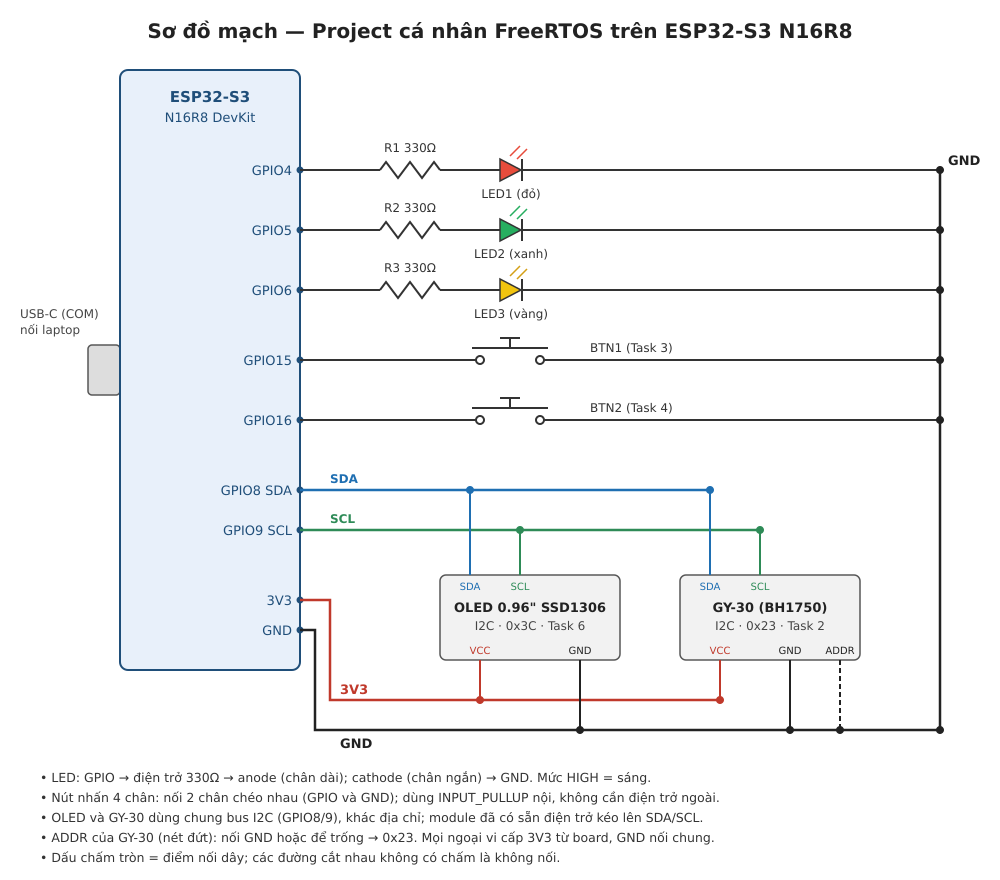
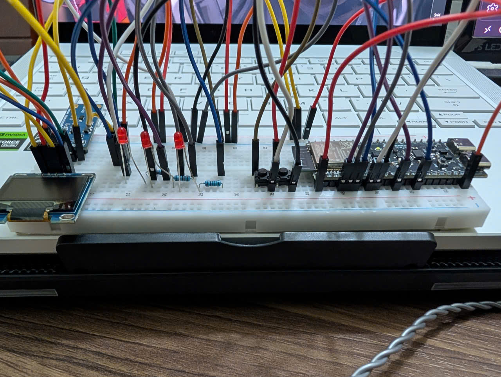
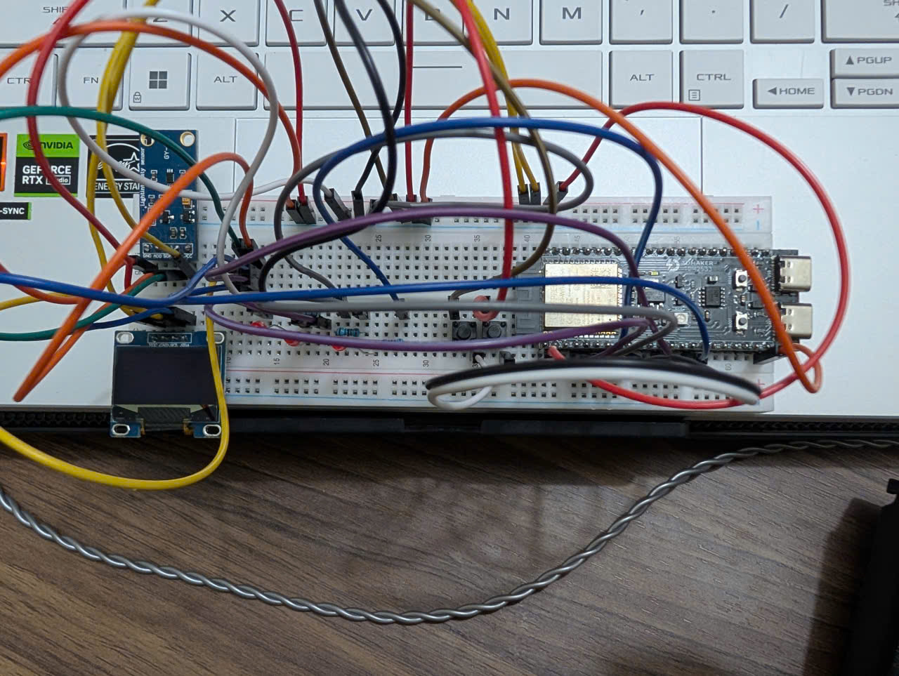
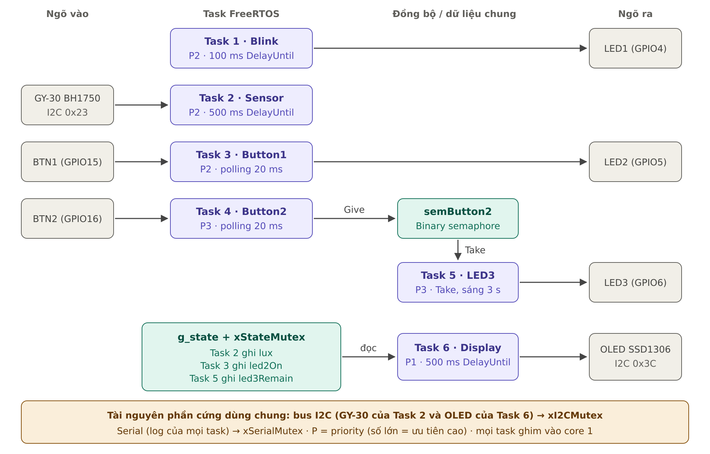
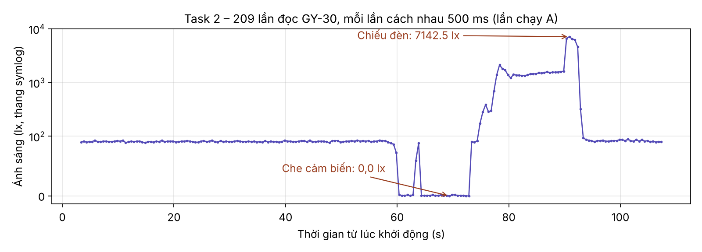
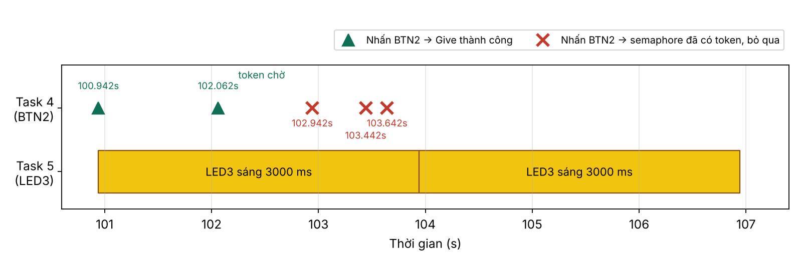
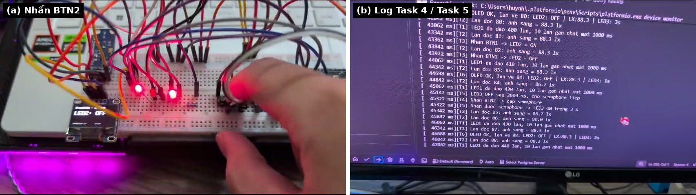

<div align="center">

# RTOS_70 — Ứng dụng đa nhiệm FreeRTOS trên ESP32-S3

**Project cá nhân (70%) · Môn Hệ điều hành thời gian thực (RTOS)**


</div>

---

## 1. Giới thiệu

Dự án xây dựng một ứng dụng nhúng **đa nhiệm** trên vi điều khiển **ESP32-S3**, dùng hệ điều hành thời gian thực **FreeRTOS**. Mỗi chức năng là một *task* chạy song song dưới sự điều phối của bộ lập lịch: điều khiển LED, đọc nút nhấn, đọc cảm biến ánh sáng và hiển thị lên màn hình OLED.

Dự án minh hoạ các kiến thức cốt lõi của FreeRTOS, mỗi kỹ thuật đều có log và video chạy thực tế làm minh chứng:

| Kiến thức | Áp dụng trong dự án |
|---|---|
| Tạo task, độ ưu tiên, ghim lõi | `xTaskCreatePinnedToCore`, 6 task trên core 1 |
| Delay tuần hoàn, không trôi | `vTaskDelayUntil` (Task 1, 2, 6) |
| Polling nhường CPU | `vTaskDelay` + chống dội phím (Task 3, 4) |
| Mutex bảo vệ dữ liệu / tài nguyên | `xStateMutex`, `xI2CMutex`, `xSerialMutex` |
| Đồng bộ sự kiện | Binary semaphore `semButton2` (Task 4 → Task 5) |
| Phòng tránh deadlock | Không task nào giữ hai mutex cùng lúc |

## 2. Yêu cầu và trạng thái

| Task | Yêu cầu | Trạng thái |
|:--:|---|:--:|
| 1 | LED1 nhấp nháy với chu kỳ T = 200 ms | ✅ |
| 2 | Đọc cảm biến ánh sáng 500 ms/lần, lưu vào biến toàn cục | ✅ |
| 3 | Button1 đảo trạng thái LED2 (polling trong vòng lặp) | ✅ |
| 4 | Nhấn Button2 để cấp (give) Binary Semaphore | ✅ |
| 5 | Đợi Binary Semaphore; khi có thì bật LED3 trong 3 s rồi tắt | ✅ |
| 6 | Hiển thị LED2, giá trị ánh sáng, LED3 (đếm ngược → Off) lên OLED, 500 ms/lần | ✅ |
| 7+ | Kỹ thuật FreeRTOS mở rộng | 📝 Đề xuất (xem báo cáo, mục 5.3) |

## 3. Phần cứng

| Linh kiện | Ghi chú |
|---|---|
| ESP32-S3 N16R8 | 2 lõi LX7 240 MHz, Flash 16 MB, PSRAM 8 MB |
| 3 LED + 3 điện trở 330 Ω | LED1, LED2, LED3 |
| 2 nút nhấn 6×6 mm | Button1, Button2 (`INPUT_PULLUP`, nhấn = LOW) |
| GY-30 (BH1750) | Cảm biến ánh sáng I2C, địa chỉ `0x23` |
| OLED 0,96" SSD1306 | 128×64, I2C, địa chỉ `0x3C` |

**Sơ đồ chân**

| Ngoại vi | GPIO |
|---|:--:|
| LED1 / LED2 / LED3 | 4 / 5 / 6 |
| Button1 / Button2 | 15 / 16 |
| I2C SDA / SCL (dùng chung OLED + GY-30) | 8 / 9 |

Các chân được chọn tránh những chân bị chiếm trên module N16R8: GPIO26–37 (Flash, Octal PSRAM), GPIO0/3/45/46 (strapping), GPIO19/20 (USB), GPIO43/44 (UART0).

<p align="center">
  
</p>

<p align="center">
  
  
</p>

## 4. Kiến trúc phần mềm

<p align="center">
  
</p>

| Task | Hàm | Kích hoạt | Ưu tiên | Stack (byte) | Cơ chế FreeRTOS |
|:--:|---|---|:--:|:--:|---|
| 1 | `vTask1_Blink` | Mỗi 100 ms | 2 | 3072 | `vTaskDelayUntil` |
| 2 | `vTask2_Sensor` | Mỗi 500 ms | 2 | 4096 | `vTaskDelayUntil` + `xI2CMutex` + `xStateMutex` |
| 3 | `vTask3_Button1` | Quét 20 ms | 2 | 3072 | `vTaskDelay` + `xStateMutex` |
| 4 | `vTask4_Button2` | Quét 20 ms | 3 | 3072 | `vTaskDelay` + `xSemaphoreGive` |
| 5 | `vTask5_Led3` | Khi có semaphore | 3 | 3072 | `xSemaphoreTake(portMAX_DELAY)` |
| 6 | `vTask6_Display` | Mỗi 500 ms | 1 | 4096 | `vTaskDelayUntil` + `xStateMutex` + `xI2CMutex` |

**Tài nguyên dùng chung**

| Tài nguyên | Task truy cập | Cơ chế bảo vệ |
|---|---|---|
| `g_state` (biến toàn cục) | Task 2, 3, 5 ghi; Task 6 đọc | `xStateMutex` |
| Bus I2C | Task 2 (GY-30), Task 6 (OLED) | `xI2CMutex` |
| Serial (log) | Mọi task qua `logf()` | `xSerialMutex` |
| Sự kiện nhấn Button2 | Task 4 → Task 5 | Binary semaphore `semButton2` |

> **Quy tắc chống deadlock:** không task nào giữ hai mutex cùng lúc; mỗi lần giữ mutex chỉ để sao chép dữ liệu ra biến cục bộ.

## 5. Kết quả

Hệ thống được chạy trên phần cứng thật 3 lần (A, B, C), mọi số liệu đếm trực tiếp từ log Serial có mốc thời gian trong [`evidence/logs`](evidence/logs).

| Task | Tiêu chí | Lần A | Lần B | Lần C | Đánh giá |
|:--:|---|:--:|:--:|:--:|:--:|
| 1 | 10 lần đảo LED1 mất 1000 ms | 104/104 | 128/128 | 60/60 | Đạt |
| 2 | Khoảng cách 2 lần đọc = 500 ms | 207/208 | 252/256 (±1 ms) | 118/119 | Đạt |
| 2 | Số lần đọc cảm biến lỗi | 0/209 | 0/257 | 0/120 | Đạt |
| 3 | LED2 đảo đúng mỗi lần nhấn | 56/56 | 34/34 | 14/14 | Đạt |
| 4, 5 | LED3 sáng đúng 3000 ms mỗi lượt | 14/14 | 12/12 | 9/9 | Đạt |
| 4 | Lần nhấn thừa bị bỏ qua (binary semaphore) | – | 5 | 5 | Đúng lý thuyết |
| 6 | Chu kỳ vẽ OLED 500 ms | 49/51 (±1 ms) | 63/63 | 29/29 | Đạt |

<p align="center">
  
  
</p>

**Video chạy thực tế:** [`evidence/videos/v1.mp4`](evidence/videos/v1.mp4) (≈ 60 s: nhấn Button1/Button2, che/chiếu cảm biến, OLED đếm ngược LED3).

<p align="center">
  
</p>

## 6. Cấu trúc thư mục

```text
RTOS_70/
├── firmware/                  # Mã nguồn PlatformIO
│   ├── platformio.ini         # Board ESP32-S3 N16R8, thư viện
│   ├── src/main.cpp           # Khởi tạo hệ thống + 6 task
│   ├── include/config.h       # Chân GPIO, chu kỳ, độ ưu tiên, stack
│   ├── lib/AppLogic/          # Logic thuần: chống dội, kiểm tra số đo, định dạng OLED
│   ├── monitor/               # Filter Serial Monitor tự ghi log ra file
│   └── sim/sim_tasks.cpp      # Mô phỏng logic các task trên PC
├── docs/                      # Sơ đồ mạch, nhật ký làm việc
├── evidence/                  # Minh chứng chạy thực tế
│   ├── logs/                  # Log Serial có mốc thời gian
│   ├── photos/                # Ảnh mạch
│   └── videos/                # Video chạy
├── report/                    # Báo cáo kỹ thuật (.docx) và hình minh hoạ
├── chu_thich_main_cpp.md      # Chú thích chi tiết main.cpp
└── instruction.md             # Hướng dẫn, yêu cầu đề và giải thích các task
```

## 7. Build và nạp chương trình

Yêu cầu: [VS Code](https://code.visualstudio.com/) + [PlatformIO IDE](https://platformio.org/install/ide?install=vscode) (hoặc PlatformIO Core).

```bash
cd firmware

pio run -e esp32s3_n16r8                 # biên dịch
pio run -e esp32s3_n16r8 -t upload       # nạp vào board
pio device monitor                       # mở Serial Monitor (115200 baud)
```

- Khi mở Serial Monitor, filter `tasklog` tự ghi toàn bộ log vào `evidence/logs/tasks_logs.txt` (**ghi đè** mỗi lần mở monitor; muốn giữ lại một lần chạy thì đổi tên file trước).
- `platformio.ini` đang bật cờ `-DARDUINO_USB_CDC_ON_BOOT=1` để Serial chạy qua cổng **USB** (native). Nếu cắm cổng **COM** (UART) thì xoá cờ này.

### Mô phỏng logic trên PC (không cần board)

`sim_tasks.cpp` dùng chung `app_logic.h` và `config.h` với firmware, kiểm tra Task 1–6 qua nhiều kịch bản (cảm biến lỗi, nhấn dồn dập, nhiễu phím…):

```bash
cd firmware
zig c++ -std=c++17 -O2 -Wall -Wextra -I include -I lib/AppLogic sim/sim_tasks.cpp -o sim_tasks.exe
./sim_tasks.exe 12        # số lần chạy mỗi phần (mặc định 10)
```

## 8. Tài liệu

- 📄 **Báo cáo kỹ thuật:** [`report/Report_ProjectCaNhan_FreeRTOS_ESP32.docx`](report/Report_ProjectCaNhan_FreeRTOS_ESP32.docx) — tìm hiểu FreeRTOS, thiết kế hệ thống, phân tích từng task, đánh giá kết quả.
- 📘 **Hướng dẫn và yêu cầu đề:** [`instruction.md`](instruction.md)
- 📝 **Chú thích mã nguồn:** [`chu_thich_main_cpp.md`](chu_thich_main_cpp.md)
- 🗒️ **Nhật ký làm việc:** [`docs/nhat_ky.md`](docs/nhat_ky.md)

## 9. Tài liệu tham khảo

1. Richard Barry, *Mastering the FreeRTOS Real Time Kernel – A Hands-On Tutorial Guide*.
2. [FreeRTOS Kernel Documentation](https://www.freertos.org).
3. Espressif Systems, [ESP-IDF Programming Guide – FreeRTOS (ESP32-S3)](https://docs.espressif.com).
4. ROHM Semiconductor, *BH1750FVI Datasheet*; Solomon Systech, *SSD1306 Datasheet*.
5. Bài giảng môn Hệ điều hành thời gian thực (RTOS), Bài 1–6.

---

<div align="center">
Giảng viên hướng dẫn: Huỳnh Hoàng Hà · Học kỳ 2, năm học 2025–2026
</div>
